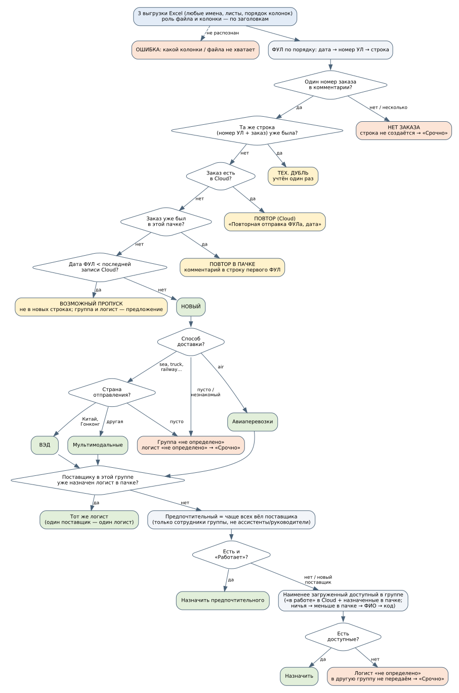

# Агент распределения ФУЛ между логистами — отчёт по тестовому заданию

**Проект:** AI-агент на GigaCowork, который распределяет новые заказы поставщиков между логистами
и готовит строки реестра Cloud строго по его форме.
**Автор:** [[ФИО]] · [[контакт]] · репозиторий: [[ссылка на GitHub]]

**Что сдаётся**

| Файл | Содержимое |
|---|---|
| `agent.zip` | навык `logist-distribution.zip` (SKILL.md + scripts/ + references/), системный промпт `system_prompt.txt`, инструкция `INSTALL.md` |
| `testdata.zip` | генератор `generate.py`, три набора данных (по 3 файла Excel), эталон по каждому ФУЛ, скрипт метрик |
| `report.pdf` | этот документ |

---

## 1. Решение в двух словах

- **Решения принимает скрипт, модель только пересказывает.** Статус ФУЛ, группу и логиста выбирает
  детерминированный Python-скрипт навыка (stdlib + `openpyxl`, для `.xls` — `xlrd`, без сети).
  Модель запускает его и копирует в чат готовый короткий ответ. Поэтому результат воспроизводим,
  объясним и не зависит от модели.
- **Запуск без текста запроса.** Пользователь прикладывает файлы в любом порядке и с любыми именами.
  Скрипт сам определяет, какой файл чем является, по заголовкам колонок. Лист может называться как
  угодно, над таблицей может быть шапка отчёта, колонки могут стоять в любом порядке и с синонимами,
  лишние колонки игнорируются, поддерживается одна книга с тремя листами.
- **Никаких выдуманных значений.** Где данных нет, скрипт пишет «не определено» и причину.
  Это проверяется автоматически на всех ловушках.
- **Каждое решение объяснимо.** Журнал решений по каждому ФУЛ: правило, обоснование и кандидаты
  группы с загрузкой. Пример: *«предпочтительный по истории Белова О. (4 из 5 заказов) недоступен:
  уволен; назначен наименее загруженный в группе: Тихонов П. (в работе 1)»*.
- **Правила вынесены в конфиг.** Синонимы заголовков, должности, состояния, способы доставки,
  страны Китая, шаблон комментария и учёт пачки в загрузке лежат в `references/*.json`.
  Ответ заказчика на открытый вопрос меняет конфиг, а не код.

**Результат на всех трёх наборах данных, 3 прогона каждого (скрипт и агент):** точность 100% по всем
полям, форма Cloud 100%, 0 выдуманных значений, результаты прогонов совпадают, ответ агента
6–8 с при пороге 60 с. Подробности в разделе 6.

---

## 2. Как устроен агент и запуск

```
Пользователь: пустое сообщение + 3 файла
        │
        ▼
Модель (системный промпт + SKILL.md) ── вызывает ──► scripts/distribute.py <все файлы> --out <папка>
        │                                               │ распознаёт файлы по заголовкам
        │                                               │ применяет правила (engine.py)
        │                                               ▼
        │                         distribution_result.xlsx · chat_message.txt · summary.json
        ▼
Ответ в чат = chat_message.txt дословно + файл результата
```

| Модуль | Что делает |
|---|---|
| `xlreader.py` | читает `.xlsx/.xls`, ищет строку заголовков в первых 30 строках, сопоставляет колонки по синонимам (сначала точное совпадение, потом по вхождению), определяет роль файла; если колонки нет, выдаёт понятную ошибку со списком найденных колонок |
| `normalize.py` | номер заказа (в том числе с кириллической «С»), ключ поставщика (регистр, пробелы, знаки, правовые формы), даты, способы доставки, страны, разбор ФИО и коротких имён |
| `engine.py` | правила: статус ФУЛ → группа → логист; загрузка, закрепление «поставщик → логист», «Требует внимания» |
| `report.py` | Excel из 7 листов и короткий ответ в чат по шаблону |
| `distribute.py` | CLI: файлы или папка в любом порядке, `--out`, коды выхода `0` / `2` |

**Инструменты и модели, в которых проверялся агент.**

1. **Claude (Anthropic), модель Claude Sonnet**, в агентном окружении (Claude Agent SDK) с эмуляцией
   GigaCowork. Каждый прогон — новый изолированный агент, который видит только системный промпт,
   папку навыка и папку вложений. Сообщение пользователя пустое. Агент сам читает SKILL.md, запускает
   скрипт и отвечает. Сделано 2 раунда по 9 прогонов (3 набора × 3).
2. **GigaChat API.** Подготовлен раннер `tools/gigachat_agent.py` (только stdlib): системный промпт
   и SKILL.md, вложения с пустым текстом запроса, function calling (`run_logist_distribution`),
   модель сама вызывает навык. Есть и упрощённый режим из ТЗ (`--mode simple`). Логи, время и метрики
   сохраняются автоматически. Логика раннера проверена на локальном mock-сервере в формате ответов
   GigaChat. [[Результаты прогонов на GigaChat-2-Max — см. раздел 6, если добавлены.]]

**Инженерная обвязка.** Код проверяется ruff (линтер и форматтер), 30 тестов на pytest/unittest
дают покрытие ядра 93%. Есть Docker-образ навыка (запуск не от root, базовый образ и индекс пакетов
подменяются на корпоративные зеркала). CI на GitHub Actions на каждый push гоняет линтер, тесты на
Python 3.9–3.13, контрольные прогоны с порогами из БТ и запуск в контейнере со сверкой с эталоном.
CD по тегу версии публикует релиз с архивами и PDF и Docker-образ. Запуск в Docker нашёл два
недочёта, которые исправлены в 1.1.1: битый файл при сбое записи и трейсбек вместо понятной ошибки,
когда нет прав на папку результата.

---

## 3. Вопросы заказчику и принятые допущения

Найдено 16 мест, где правило неоднозначно или не описано. Каждое допущение реализовано в коде,
а где возможно, вынесено в `references/rules.json`.

<!-- BEGIN:questions -->
| # | Вопрос | Кому | Зачем | Допущение до ответа |
|---|---|---|---|---|
| Д-1 | «Возможный пропуск» — это ФУЛ, дата которого раньше **максимальной** «Даты получения УЛ» в Cloud или раньше **последней по порядку** строки? Сравнивать с точностью до дня или до времени? Вносить ли такие ФУЛ в новые строки? | СР, РЛ | В Cloud нет времени, а строки могут вноситься не по порядку. От ответа зависит, сколько ФУЛ попадёт в пропуски. | Максимальная дата в Cloud, сравнение по дню; ФУЛ того же дня — не пропуск. Пропуски **не** попадают в новые строки (метрика «без старых ФУЛ»), но для них показываем предлагаемые группу и логиста. |
| Д-2 | Если в одной пачке пришло два ФУЛ по одному новому заказу — создаём одну строку по первому ФУЛ и пишем в её комментарий «Повторная отправка ФУЛа, [дата второго]»? | СР, Л | БТ требует обработать «дубль внутри пачки», но не говорит как. | Да: одна строка по самому раннему ФУЛ, комментарий о повторе с датой более позднего. |
| Д-3 | Одна и та же строка ФУЛ (тот же номер УЛ и заказ) может попасть в выгрузку дважды? Это повтор или техническая ошибка выгрузки? | ЗК (ИТ 1С) | Иначе такой «дубль» создаст ложную повторную отправку. | Технический дубль: игнорируется, пишется в журнал, повторной отправкой не считается. |
| Д-4 | Повторная отправка по заказу со статусом **confirm** (заказ уже закрыт) — просто комментарий, или это сигнал, что заказ надо вернуть «в работу»? Комментарий дописываем к существующему через «; » или заменяем? | РЛ, Л | Повтор по закрытому заказу может означать исправления, требующие действий логиста. | Комментарий дописывается через «; »; повтор по confirm дополнительно выводится в «Требует внимания». |
| Д-5 | Что считается Китаем для группы ВЭД: только материковый Китай и Гонконг (как в БТ) или ещё Макао и Тайвань? Какие написания встречаются в 1С? | РЛ, ЗК | Ошибка в стране меняет группу. | Китай = Китай/КНР/China/CN/PRC + Гонконг/Hong Kong/HK. Макао и Тайвань — не Китай. Справочник — `references/countries.json`. |
| Д-6 | Встречаются ли в 1С способы доставки кроме air, sea, truck, direct truck, railway (например, courier, express, multimodal, sea-air)? К какой группе их относить? | ЗК, РЛ | «Не air» формально включает любое значение, но courier/express могут быть авиа. | Незнакомый способ → группа «не определено» + «Требует внимания». Агент не угадывает. |
| Д-7 | Какие ещё состояния сотрудника бывают в 1С (больничный, командировка, декрет, удалённая работа)? Учитывать ли **даты** отпуска (сотрудник выходит завтра)? | РЛ, ЗК | Выгрузка даёт только текущее состояние; заказ может прийти накануне выхода из отпуска. | Доступен только «Работает». Любое другое состояние — недоступен, причина в журнале. Даты отпусков не учитываются. |
| Д-8 | Как в Cloud пишется логист, если в 1С есть однофамильцы (две Ивановы)? Есть ли единый справочник «короткое имя ↔ табельный номер»? | СР, ЗК | Без однозначного сопоставления история и загрузка будут приписаны не тому человеку. | Сопоставляем по фамилии + всем указанным инициалам. Неоднозначно → запись не засчитывается никому и выводится в «Требует внимания». |
| Д-9 | В каком формате писать логиста в новой строке Cloud: «Фамилия И.», «Фамилия И.О.» или полное ФИО? | СР | Форма реестра должна быть «строго по форме». | Как этот сотрудник уже записан в Cloud; если его там нет — в преобладающем в реестре формате. |
| Д-10 | Учитывать ли в загрузке заказы, назначенные в **этой же пачке**? Считать загрузку числом заказов «в работе» или ещё чем-то (объём, число поставщиков)? | РЛ | Если не учитывать пачку, все новые поставщики пачки уйдут одному наименее загруженному. | Загрузка = заказы «в работе» в Cloud + назначенные в текущей пачке. |
| Д-11 | Если у поставщика в одной пачке заказы разных групп (air и sea) — это два логиста или передаём всё одному? | РЛ | Правило «один поставщик — один логист» конфликтует с правилом групп. | Группа важнее: внутри каждой группы — один логист на поставщика; случай выводится в «Требует внимания». |
| Д-12 | Какой статус ставить в новой строке Cloud — «в работе» сразу или пусто до подтверждения логистом? | СР, Л | Статус влияет на подсчёт загрузки в следующих пачках. | «в работе». |
| Д-13 | Если предпочтительный логист недоступен — сразу наименее загруженный (как в БТ) или сначала **второй** по истории работы с поставщиком? | РЛ | Второй по истории знает поставщика, но БТ говорит про загрузку. | Строго по БТ: наименее загруженный доступный в группе. Второй по истории показывается в обосновании. |
| Д-14 | Ничья по истории и по загрузке — как разрешать? (БТ: «правила разрешения ничьих» — от заказчика.) | РЛ | Без правила результат станет случайным и невоспроизводимым. | История: позже последний заказ с поставщиком → меньше загрузка. Загрузка: меньше назначений в пачке → ФИО по алфавиту → табельный номер. |
| Д-15 | Влияет ли колонка «Статус» ФУЛ в 1С (например, «Отменён», «Черновик») и колонка «Логист» в 1С на распределение? | ЗК, СР | Отменённый ФУЛ не должен создавать заказ; логист в 1С может уже быть назначен. | Статус и логист из 1С на решение не влияют, но показываются в журнале. |
| Д-16 | Учитывать ли в истории только заказы со статусом confirm (завершённые) или все? Есть ли «срок давности» истории? | РЛ | Старые связи с поставщиком могут быть неактуальны. | Все строки Cloud без ограничения по времени. |
<!-- END:questions -->

---

## 4. Алгоритм распределения

Схема целиком — в конце раздела.

**Таблица решений: группа**

| Способ доставки | Страна отправления | Группа |
|---|---|---|
| `air` | любая, в том числе пустая | Авиаперевозки (если страна пустая: «не определено» в колонке страны + «Проверить») |
| не `air` (sea, truck, direct truck, railway) | Китай / КНР / China / Гонконг / HK | ВЭД |
| не `air` | другая | Мультимодальные перевозки |
| не `air` | пусто, «-», «н/д» | **не определено** |
| пусто или незнакомое значение (`courier`) | любая | **не определено** |

**Псевдокод выбора логиста**

```
кандидаты = сотрудники группы − ассистенты/помощники − руководители/начальники
если поставщику в этой группе уже назначен логист в пачке:  → он же
история = сколько заказов поставщика в Cloud вёл каждый кандидат
          (имена Cloud ↔ ФИО 1С; неоднозначные имена не засчитываются)
предпочтительный = max(история); ничья → позже последний заказ → меньше загрузка → ФИО → код
если предпочтительный «Работает»:                       → он
иначе (новый поставщик / в отпуске / уволен / состояние не «Работает»):
    доступные = кандидаты со статусом «Работает»
    если доступные пусты:   → «не определено», в другую группу не передаём, «Срочно»
    → min(загрузка = «в работе» в Cloud + назначено в пачке; меньше в пачке; ФИО; код)
```

**Сложные случаи**

| Случай | Что делает агент |
|---|---|
| Повторная отправка ФУЛ | заказ есть в Cloud → строку не создаёт, лист «Повторные отправки» с текущим и итоговым комментарием «…; Повторная отправка ФУЛа, ДД.ММ.ГГГГ» (несколько повторов → все даты) |
| Повтор внутри пачки | одна строка по самому раннему ФУЛ, в её комментарии «Повторная отправка ФУЛа, дата второго» |
| Точная копия строки выгрузки | технический дубль, учитывается один раз |
| Новый поставщик | наименее загруженный доступный в группе |
| Предпочтительный в отпуске / уволен | наименее загруженный доступный; в обосновании написано, кто был предпочтительным и почему недоступен |
| Все сотрудники группы недоступны | логист «не определено», «Срочно», в другую группу не передаётся |
| Нет номера заказа (или два разных) | строка не создаётся, «Срочно» |
| Нет способа доставки / страны | строка создаётся, группа и логист «не определено» (для air без страны логист назначается) |
| ФУЛ раньше последней записи Cloud | «Возможный пропуск»: не в новых строках, но с предложенными группой и логистом |
| Поставщик записан по-разному | один ключ поставщика; в строку идёт написание из Cloud. Похожие, но разные названия не склеиваются, а выводятся на проверку |

**Схема алгоритма**



---

## 5. Тестовые данные и эталон

Данные генерирует `testdata/generate.py` (детерминированно). **Эталон задан вручную по каждому ФУЛ**
(статус, группа, логист, комментарий и описание ловушки) и не вычисляется кодом агента, так что
проверка не замкнута сама на себя. Корректность оценщика проверена мутационно: изменённый эталон
даёт ожидаемые расхождения.

| Набор | ФУЛ | Cloud | Сотрудники | Назначение |
|---|---|---|---|---|
| `ds1_base` | 28 | 51 | 11 | все ловушки из ТЗ |
| `ds2_format` | 28 | 51 | 11 | те же данные в «чужом» формате: другие имена файлов и листов, шапка над таблицей, переставленные и лишние колонки, синонимы заголовков, даты текстом, сотрудники в `.xls`. Так проверяется требование «колонки по заголовкам, а не по номеру» |
| `ds3_edge` | 16 | 24 | 10 | однофамильцы, кириллическая «С», два номера в комментарии, `courier`, недоступная авиагруппа, больничный, ничья по загрузке, похожие названия поставщиков |

**Покрытие ловушек (ds1_base)**

<!-- BEGIN:coverage -->
| Требование ТЗ | ФУЛ | Что обязан сделать агент |
|---|---|---|
| Все три группы | 0103 (авиа), 0101 (ВЭД), 0105 (мультимодальные) | группа по правилу |
| Повтор заказа, который есть в Cloud | 0104, 0116, 0127, 0086 | строку не создавать, комментарий «Повторная отправка ФУЛа, дата» |
| Повтор внутри пачки | 0114 (к 0101) | одна строка, комментарий о повторе в ней |
| Технический дубль строки | 0123 (вторая) | учесть один раз |
| Новый поставщик | 0106, 0107 | наименее загруженный в группе |
| Предпочтительный логист в отпуске | 0103 (Захарова) | наименее загруженный |
| Предпочтительный логист уволен | 0102 (Белова) | наименее загруженный |
| Группа, где все недоступны | 0105, 0118, 0121, 0125 (мультимодальные) | логист «не определено», в другую группу не передавать |
| Ассистент и руководитель | Фёдорова, Громов, Назарова | никогда не назначаются, в истории не учитываются |
| ФУЛ без номера заказа | 0108 | строку не создавать, «Требует внимания» |
| ФУЛ без способа доставки | 0111 | группа и логист «не определено» |
| ФУЛ без страны | 0112 (sea) / 0113 (air) | sea → «не определено»; air → группа определяется, страна «не определено» |
| ФУЛ раньше последней записи Cloud | 0090 | возможный пропуск, не в новых строках |
| Старый ФУЛ, но заказ есть в Cloud | 0086 | повтор, а не пропуск |
| Поставщик записан по-разному | 0110 («GOLDEN  THREAD CO LTD»), 0126 («silk road  apparel ») | тот же поставщик, написание из Cloud |
| Один поставщик — один логист | 0113, 0115, 0122, 0123, 0126, 0128 | тот же логист, что у первого ФУЛ поставщика |
| Ничья по истории | 0117 | у кого позже последний заказ поставщика |
| Поставщик в двух группах | Lotus Fashion: 0109 (air) и 0125 (sea) | «Требует внимания» |
| Повтор по заказу в статусе confirm | 0116 | «Требует внимания» |
| Нет cut-off | 0128 | «не определено» в строке |
| Логист в Cloud не найден в 1С | «Петров С.» | его заказы не учитываются, «Требует внимания» |
<!-- END:coverage -->

---

## 6. Результаты прогонов и метрики

Метрики считает `tools/evaluate.py`, сводку собирает `tools/run_control.py`
(`runs/REPORT.md`, `runs/metrics.json`). Для каждого прогона в `runs/<набор>/<исполнитель>_<N>/`
лежат результат Excel, `log.json` и транскрипт.

<!-- BEGIN:runs -->
Пороги из БТ: точность ≥ 95%, форма Cloud 100% прогонов, 0 выдуманных значений, одинаковый результат во всех прогонах, обоснование у каждого назначения, ответ ≤ 60 с. Дополнительно: ответ модели в чат дословно совпадает с шаблоном скрипта, без служебных строк.

Исполнители: `script` — скрипт навыка напрямую; `claude` — агентный прогон (Claude Sonnet, навык v1.1); `claude-v1` — первый раунд на навыке v1.0, по итогам которого исправлен ответ в чат; `gigachat_agent` — tools/gigachat_agent.py.

| Набор | Исполнитель | Прогонов | Совпадение ФУЛ целиком (мин.) | Статус | Группа | Логист | Комментарий | Ячейки новых строк | Форма Cloud | Выдумано | Воспроизводимо | Ответ в чат = шаблон | Время ср./макс., с | Итог |
|---|---|---|---|---|---|---|---|---|---|---|---|---|---|---|
| ds1_base | claude | 3 | 100.0% | 100.0% | 100.0% | 100.0% | 100.0% | 100.0% | да | 0 | да | 3/3 | 7.15 / 7.73 | ✅ |
| ds1_base | claude-v1 | 3 | 100.0% | 100.0% | 100.0% | 100.0% | 100.0% | 100.0% | да | 0 | да | 3/3 | 7.94 / 8.29 | ✅ |
| ds1_base | script | 3 | 100.0% | 100.0% | 100.0% | 100.0% | 100.0% | 100.0% | да | 0 | да | — (без модели) | 0.23 / 0.25 | ✅ |
| ds2_format | claude | 3 | 100.0% | 100.0% | 100.0% | 100.0% | 100.0% | 100.0% | да | 0 | да | 3/3 | 6.43 / 6.53 | ✅ |
| ds2_format | claude-v1 | 3 | 100.0% | 100.0% | 100.0% | 100.0% | 100.0% | 100.0% | да | 0 | да | 1/3 | 7.99 / 8.4 | ❌ |
| ds2_format | script | 3 | 100.0% | 100.0% | 100.0% | 100.0% | 100.0% | 100.0% | да | 0 | да | — (без модели) | 0.23 / 0.25 | ✅ |
| ds3_edge | claude | 3 | 100.0% | 100.0% | 100.0% | 100.0% | 100.0% | 100.0% | да | 0 | да | 3/3 | 6.52 / 7.08 | ✅ |
| ds3_edge | claude-v1 | 3 | 100.0% | 100.0% | 100.0% | 100.0% | 100.0% | 100.0% | да | 0 | да | 3/3 | 9.68 / 10.94 | ✅ |
| ds3_edge | script | 3 | 100.0% | 100.0% | 100.0% | 100.0% | 100.0% | 100.0% | да | 0 | да | — (без модели) | 0.2 / 0.2 | ✅ |
<!-- END:runs -->

**Что выявили прогоны и что исправлено.** В первом раунде агентных прогонов (`claude-v1`, навык v1.0)
Excel-результат был верным во всех 9 прогонах. Но при пересказе длинного ответа в чат модель дважды
оставила служебную строку `=== КОНЕЦ ОТВЕТА ===` и один раз исказила текст («не-air» → «не-address»).
Что сделано:

1. ответ в чат сокращён: срочные вопросы сгруппированы по типу со списком номеров ФУЛ;
2. готовый ответ дополнительно сохраняется в `chat_message.txt`;
3. в SKILL.md и системном промпте явно сказано копировать его дословно, без служебных строк;
4. в оценку добавлена метрика «ответ в чат = шаблон».

Во втором раунде (`claude`, навык v1.1) все 9 ответов совпали с шаблоном дословно.

**Время ответа.** Скрипт работает 0,2–0,3 с на пачку. Полный ответ агента — 6–8 с.
При реальных 65 ФУЛ время скрипта растёт линейно и остаётся меньше секунды.

---

## 7. Лог одного прогона

<!-- BEGIN:transcript -->
### Агентный прогон (claude Claude Sonnet) — ds1_base, прогон 1

**Пользователь:** пустое сообщение + вложения: `1c_ful.xlsx`, `1c_staff.xlsx`, `cloud_registry.xlsx`

**Вывод скрипта навыка:**

```
=== ОТВЕТ ДЛЯ ЧАТА ===
Готово: distribution_result.xlsx
• Новых строк для Cloud: 20 (с логистом — 14, без логиста — 6)
• Повторных отправок: 5 (заказ уже в Cloud — 4, дубль в пачке — 1)
• Возможных пропусков: 1
• Вопросов, требующих решения: 13 (срочных — 7)
Срочно:
  – нет номера заказа — строка не создана: УЛ-26-0108
  – группа не определена (нет или незнакомый способ доставки / страна): УЛ-26-0111, УЛ-26-0112
  – в группе нет доступных логистов: УЛ-26-0105, УЛ-26-0118, УЛ-26-0121, УЛ-26-0125
Подробности — на листах «Требует внимания» и «Журнал решений».
=== КОНЕЦ ОТВЕТА ===
Файл результата: /tmp/harness/sessions/ds1_base_1/outputs/distribution_result.xlsx
Сводка JSON: /tmp/harness/sessions/ds1_base_1/outputs/summary.json
Время работы скрипта: 0.16 с
```

**Ответ агента в чат:**

```text
Готово: distribution_result.xlsx
• Новых строк для Cloud: 20 (с логистом — 14, без логиста — 6)
• Повторных отправок: 5 (заказ уже в Cloud — 4, дубль в пачке — 1)
• Возможных пропусков: 1
• Вопросов, требующих решения: 13 (срочных — 7)
Срочно:
  – нет номера заказа — строка не создана: УЛ-26-0108
  – группа не определена (нет или незнакомый способ доставки / страна): УЛ-26-0111, УЛ-26-0112
  – в группе нет доступных логистов: УЛ-26-0105, УЛ-26-0118, УЛ-26-0121, УЛ-26-0125
Подробности — на листах «Требует внимания» и «Журнал решений».
```


Время ответа: 6.18 с. Ответ совпал с шаблоном: да; служебные маркеры в ответе: нет.

<!-- END:transcript -->

**Фрагмент результата (ds1_base): лист «Журнал решений»**

<!-- BEGIN:journal -->
| Номер ФУЛ | Заказ | Статус обработки | Группа | Логист | Обоснование |
|---|---|---|---|---|---|
| УЛ-26-0086 | S0003077 | Повторная отправка (заказ есть в Cloud) |  | Ким Д. | заказ S0003077 уже есть в Cloud (строка 31, логист Ким Д., статус в работе) |
| УЛ-26-0090 | S0004090 | Возможный пропуск | Авиаперевозки | Орлова М. | заказа нет в Cloud, но ФУЛ от 05.11.2026 раньше последней записи Cloud (06.11.2026); Орлова М.: поставщик «Lotus Fashion Ltd» в этой пачке уже закреплён за логистом Орлова М. (один поставщик — один логист); в работе 5 |
| УЛ-26-0101 | S0004101 | Новый | ВЭД | Ким Д. | Ким Д.: вёл(а) 3 из 3 заказов поставщика «Silk Road Apparel» в Cloud (история в группе: Ким Д. — 3); работает, в работе 3 |
| УЛ-26-0102 | S0004102 | Новый | ВЭД | Тихонов П. | предпочтительный по истории Белова О. (4 из 5 заказов) недоступен: уволен; назначен наименее загруженный в группе: Тихонов П. (в работе 1) |
| УЛ-26-0103 | S0004103 | Новый | Авиаперевозки | Лебедев А. | предпочтительный по истории Захарова И. (3 из 4 заказов) недоступен: в отпуске (Ежегодный оплачиваемый отпуск); назначен наименее загруженный в группе: Лебедев А. (в работе 2) |
| УЛ-26-0104 | S0003050 | Повторная отправка (заказ есть в Cloud) |  | Орлова М. | заказ S0003050 уже есть в Cloud (строка 14, логист Орлова М., статус в работе) |
| УЛ-26-0105 | S0004105 | Новый | Мультимодальные перевозки | не определено | предпочтительный по истории Соколов И. (2 из 2 заказов) недоступен: в отпуске (Отпуск по уходу за ребенком); в группе «Мультимодальные перевозки» нет доступных логистов — заказ остаётся без логиста, в другую группу не передаётся |
| УЛ-26-0106 | S0004106 | Новый | ВЭД | Тихонов П. | новый поставщик — в Cloud нет его заказов; назначен наименее загруженный в группе: Тихонов П. (в работе 2) |
| УЛ-26-0107 | S0004107 | Новый | Авиаперевозки | Лебедев А. | новый поставщик — в Cloud нет его заказов; назначен наименее загруженный в группе: Лебедев А. (в работе 3) |
| УЛ-26-0108 | не определено | Нет номера заказа |  |  | в комментарии нет номера заказа (комментарий: «Номер: от 08.11.2026») |
| УЛ-26-0109 | S0004109 | Новый | Авиаперевозки | Орлова М. | Орлова М.: вёл(а) 2 из 2 заказов поставщика «Lotus Fashion Ltd» в Cloud (история в группе: Орлова М. — 2); работает, в работе 4 |
| УЛ-26-0110 | S0004110 | Новый | Авиаперевозки | Лебедев А. | Лебедев А.: вёл(а) 3 из 4 заказов поставщика «Golden Thread Co., Ltd» в Cloud (история в группе: Лебедев А. — 3); работает, в работе 4 |

*Показаны первые 12 из 28 ФУЛ.*
<!-- END:journal -->

---

## 8. Что доработать дальше

1. **Прогоны на GigaChat в стенде GigaCowork заказчика** и сверка с решениями сотрудника
   распределения на обезличенных реальных данных: какая доля назначений совпадает и где расходится.
2. **Ответы заказчика на 16 вопросов.** Перенести их в `rules.json`, обновить эталон и тесты.
3. **Даты отпусков.** Если 1С может выгружать период отсутствия, учитывать выход сотрудника
   до cut-off.
4. **Справочник «короткое имя ↔ табельный номер»** вместо эвристики по фамилии и инициалам.
   Это снимает проблему однофамильцев.
5. **Готовая вставка в Cloud:** при необходимости выдавать файл того же формата, что и реестр,
   с подсветкой новых строк.
6. **Черновик письма логисту** по назначенным заказам. Следующий типовой сценарий того же класса
   агентов, как «подтверждение отклонений упаковочных листов».
7. **Мониторинг качества:** доля ручных переназначений после агента как основная метрика пилота.

---

<!-- BEGIN:motivation -->
## Мотивация участия в проекте

> ЧЕРНОВИК — отредактируйте под себя: ответы должны быть вашими словами.
> Места, которые нужно заполнить, отмечены [[ ]].

**1. Почему тебе интересен этот проект?**

Мне интересно делать агентов, которые доводят задачу до готового результата, а не просто
отвечают в чате. На последних двух хакатонах я разрабатывал AI-агентов
([[кратко: какие задачи, что получилось, место]]) и увидел главную проблему таких решений:
модель выглядит убедительно, но в бизнес-процессе ошибается там, где цена ошибки высокая.
В этом проекте правильная архитектура видна сразу: правила заказчика исполняет детерминированный
код, а модель отвечает за запуск, объяснение и общение. Именно такие агенты реально внедряют.
Ещё мне нравится, что кейс типовой («выгрузки Excel → правила → готовый файл»): сделанный
хорошо, он становится шаблоном для следующих агентов.

**2. Как ты видишь свою роль в команде, которая создаёт продукт?**

Разработчик агентов полного цикла: разобрать процесс с заказчиком и сформулировать вопросы,
описать правила и допущения, написать навык и скрипты, собрать синтетические данные с ловушками
и эталоном, настроить контрольные прогоны и метрики. Мне важно, чтобы каждое решение агента
можно было проверить и объяснить заказчику, поэтому я беру на себя и качество: тесты, приёмку,
понятную документацию. [[добавьте, что вам ближе: общение с заказчиком, архитектура, тестирование]]

**3. Сколько времени в неделю ты готов(а) уделять проекту и в течение какого периода?**

[[N]] часов в неделю в течение [[срок, например «4 месяцев» / «до конца проекта»]].
<!-- END:motivation -->
